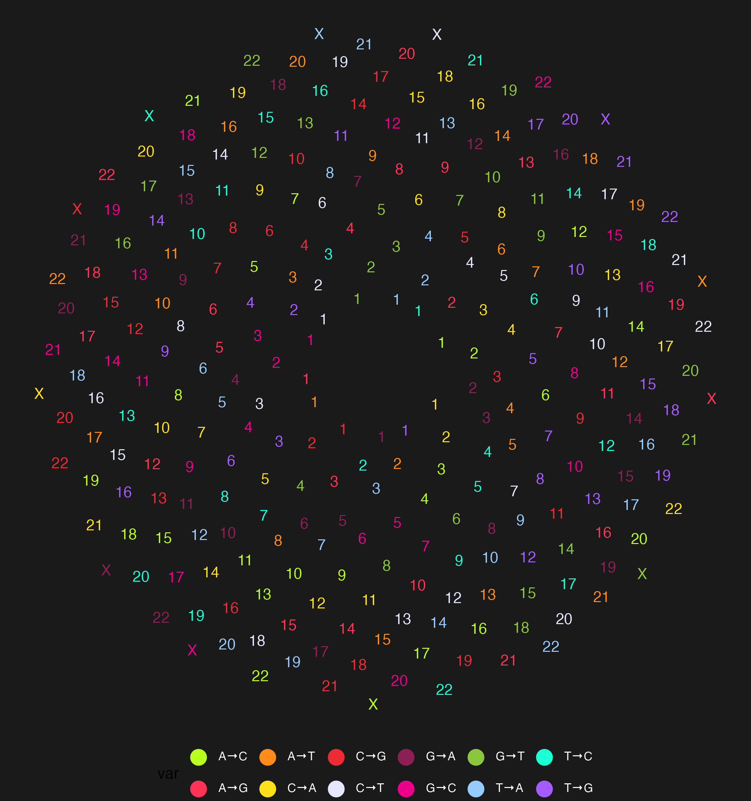

## gnome-viz

I enjoy finding new abstract ways to visualize my whole-genome sequencing data and this is where I store them. These visualizations are not meant to be informative in any way - just look pretty!

### Phyllotaxis visual

This one was inspired by Nadieh Bremer and a phyllotaxis visualization she recently made (see her portfolio [here](https://www.visualcinnamon.com/portfolio/blank-bio/)). I saw it and thought "I wonder what my genome would look like as a phyllotaxis diagram".

The data I used for this was the number of different types of variants (mutations) I have on each chromosome. The innermost ring of the diagram represents chromosome 1 and the outermost ring represents the X chromosome. The colour of the points represents the type of variant (e.g. A&rarr;C, T&rarr;G, etc.) and the size of the points represents the number of variants. 

